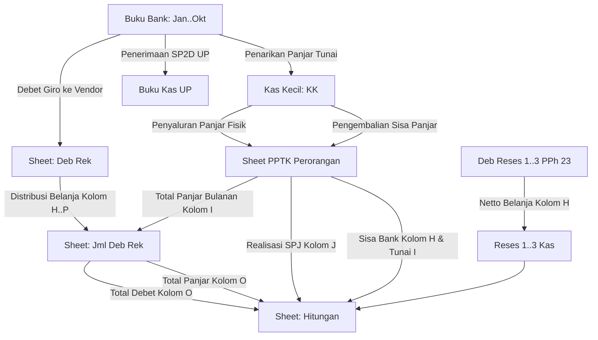

# DOKUMEN ANALISIS WORKBOOK KEUANGAN INTERNAL
## SEKRETARIAT DPRD KABUPATEN BANYUMAS — TAHUN ANGGARAN 2026

---

## 1. PENDAHULUAN & TUJUAN ANALISIS

Dokumen ini disusun sebagai hasil analisis menyeluruh (*deep forensic analysis*) terhadap dua workbook Excel pembukuan keuangan internal pada Bagian Keuangan Sekretariat DPRD Kabupaten Banyumas:
1. **File A:** `BKU Per PPTK 2026 (1).xlsx` (20 sheet, 872 KB)
2. **File B:** `BUKU BANK 2026 (1).xlsx` (10 sheet aktif Jan–Okt, 958 KB)

Analisis ini menjadi fondasi utama dalam perancangan arsitektur sistem, skema database, mesin perhitungan otomatis, parser impor transaksi, serta antarmuka digitalisasi dengan prinsip utama:
> **"TAMPILAN EXCEL DIPERTAHANKAN — PROSES PENCATATAN DIOTOMATISASI."**

---

## 2. INVENTARISASI SELURUH SHEET & FUNGSI OPERASIONAL

### 2.1. File A — BKU Per PPTK 2026 (20 Sheet)

| No | Nama Sheet | Dimensi (Baris x Kolom) | Kategori | Fungsi Operasional Utama |
|:--:|:-----------|:-----------------------:|:---------|:--------------------------|
| 1 | `Hitungan` | 326 x 17 | Rekapitulasi Eksekutif | Dashboard rekonsiliasi total hutang panjar, debet rekening, realisasi SPJ, dan saldo kas per PPTK. Memuat validasi selisih `=G-L` yang harus bernilai 0, serta riwayat *snapshot* berkala per tanggal cut-off. |
| 2 | `UP` | 1832 x 8 | Buku Kas Induk | Buku Kas Umum khusus mutasi Uang Persediaan (UP) dari awal SP2D UP diterima (Rp 720.000.000) hingga penarikan tunai dan debet rekening operasional Setwan. |
| 3 | `KK` | 1003 x 8 | Buku Kas Tunai | Buku Kas Kecil (Kas Tunai Bendahara). Mencatat fisik kas tunai yang ditarik dari bank ke brankas, penyaluran panjar tunai ke PPTK, serta pengembalian sisa panjar tunai oleh PPTK. |
| 4 | `Jml Deb Rek`| 1000 x 19 | Matriks Bulanan | Matriks akumulasi bulanan (Januari s.d. Desember) atas Debet Rekening dan Panjar per masing-masing PPTK, lengkap dengan baris *manual adjustments* catatan koreksi. |
| 5 | `Deb Rek` | 3673 x 26 | Buku Pembantu Debet | Buku Panjar/Debet Rekening induk. Mencatat setiap transaksi non-tunai langsung melalui debet rekening giro ke rekening penyedia/toko (misal Rita Pasaraya, bengkel Nasmoco, dsb) dan mendistribusikannya ke kolom masing-masing PPTK (Kolom H s.d. P). |
| 6 | `Aul-Ety` | 1216 x 14 | Buku PPTK | Buku Pembantu PPTK: Ibu Chazanah Aulia Nadiyanti, S.T. (Bagian/Bidang Ety). Mencatat panjar, pengembalian, debet rekening, dan SPJ kegiatan terkait. |
| 7 | `Gaya` | 1071 x 14 | Buku PPTK | Buku Pembantu PPTK: Ibu Gayatri. |
| 8 | `Ratman` | 1554 x 24 | Buku PPTK | Buku Pembantu PPTK: Bapak Suratman, S.E. Mengelola volume transaksi debet operasional kantor terbesar (logistik, jamuan, pemeliharaan gedung/mobil). |
| 9 | `Aul-Rina` | 998 x 14 | Buku PPTK | Buku Pembantu PPTK: Ibu Chazanah Aulia Nadiyanti, S.T. (Bagian/Bidang Rina). |
| 10 | `Sigit` | 1064 x 26 | Buku PPTK | Buku Pembantu PPTK: Bapak Sigit Dwi Yunianto, S.H. |
| 11 | `SgngSyesa` | 1034 x 26 | Buku PPTK | Buku Pembantu PPTK: Bapak Sugeng Budi W. / Syesaria. |
| 12 | `SgngEmi` | 996 x 14 | Buku PPTK | Buku Pembantu PPTK: Bapak Sugeng Budi W. / Emi. |
| 13 | `Sri L` | 990 x 14 | Buku PPTK | Buku Pembantu PPTK: Ibu Sri Lestari. |
| 14 | `Irna` | 997 x 14 | Buku PPTK | Buku Pembantu PPTK: Ibu Irnawatingrum, S.S.TP., M.Si. |
| 15 | `Reses 1` | 1000 x 12 | Buku Kegiatan Khusus | Buku Kas Kegiatan Reses Masa Sidang 1 DPRD Kab. Banyumas (Penerimaan SP2D TU Reses Rp 465.700.000, pengeluaran sewa tempat, ATK, mamin, dan sisa kas bank). |
| 16 | `Deb Reses1` | 974 x 26 | Debet Pajak Reses | Rincian debet rekening kegiatan Reses 1 dengan kalkulasi otomatis Bruto, PPh 23 (2%), Netto, SPJ, PPh SPJ, Netto SPJ, dan sisa setoran ke Kasda. |
| 17 | `Reses2` | 1000 x 12 | Buku Kegiatan Khusus | Buku Kas Kegiatan Reses Masa Sidang 2 DPRD Kab. Banyumas. |
| 18 | `Deb Reses2` | 974 x 26 | Debet Pajak Reses | Rincian debet rekening kegiatan Reses 2 dengan rincian pajak pemotongan PPh 23. |
| 19 | `Reses3` | 1000 x 12 | Buku Kegiatan Khusus | Buku Kas Kegiatan Reses Masa Sidang 3 DPRD Kab. Banyumas. |
| 20 | `DebReses3` | 1001 x 26 | Debet Pajak Reses | Rincian debet rekening kegiatan Reses 3 dengan rincian pajak pemotongan PPh 23. |

---

### 2.2. File B — Buku Bank 2026 (10 Sheet)

Workbook ini memuat mutasi harian rekening giro resmi Bendahara Pengeluaran Setwan di Bank Jateng Cabang Purwokerto:

| No | Nama Sheet | Baris x Kolom | Pejabat Pengguna Anggaran (PA/Sekwan) | Bendahara Pengeluaran | Karakteristik Mutasi |
|:--:|:-----------|:-------------:|:-------------------------------------|:-----------------------|:----------------------|
| 1 | `Jan` | 1058 x 26 | SUMARDI, S.H., M.Hum. | INDAH SETIYOWATI, A.Md.AB. | Mulai saldo Rp 0. Penerimaan SP2D LS Gaji DPRD, SP2D UP (Rp 720 jt), penarikan panjar, dan debet belanja langsung. |
| 2 | `Feb` | 1215 x 26 | SUMARDI, S.H., M.Hum. | INDAH SETIYOWATI, A.Md.AB. | Saldo awal `=Jan!F124`. Transaksi SP2D LS Gaji & Tunjangan, TU Reses 1, GU 1. |
| 3 | `Maret` | 1149 x 26 | SUMARDI, S.H., M.Hum. | INDAH SETIYOWATI, A.Md.AB. | Saldo awal `=Feb!F281`. Mutasi GU 2, realisasi perjalanan dinas, debet rutin. |
| 4 | `April` | 1161 x 26 | SUMARDI, S.H., M.Hum. | INDAH SETIYOWATI, A.Md.AB. | Saldo awal `=Maret!F...`. Periode penutupan kuartal 1 dan pergantian PA. |
| 5 | `Mei` | 1114 x 26 | Drs. NUNGKY HARRY RACHMAT, M.Si | INDAH SETIYOWATI, A.Md.AB. | Pejabat PA beralih ke Drs. Nungky Harry Rachmat, M.Si. Mutasi TU Reses 2. |
| 6 | `Juni` | 1123 x 26 | Drs. NUNGKY HARRY RACHMAT, M.Si | INDAH SETIYOWATI, A.Md.AB. | Saldo berjalan dan mutasi semester I. |
| 7 | `Juli` | 1292 x 26 | Drs. NUNGKY HARRY RACHMAT, M.Si | INDAH SETIYOWATI, A.Md.AB. | Mutasi belanja gaji, tunjangan, dan GU berjalan. |
| 8 | `Agust` | 1128 x 26 | Drs. NUNGKY HARRY RACHMAT, M.Si | INDAH SETIYOWATI, A.Md.AB. | Mutasi bulan kemerdekaan dan kegiatan dewan. |
| 9 | `Sept` | 1213 x 26 | ARIF TRIYANTO, S.Sos. M.Eng. | INDAH SETIYOWATI, A.Md.AB. | Pejabat PA beralih ke Arif Triyanto, S.Sos. M.Eng. Persiapan TU Reses 3. |
| 10 | `Okt` | 1285 x 29 | ARIF TRIYANTO, S.Sos. M.Eng. | INDAH SETIYOWATI, A.Md.AB. | Mutasi bulan Oktober 2026. Data aktif terkini. |

---

## 3. STRUKTUR DETAIL HEADER, KOLOM, SUB-KOLOM, DAN SEL GABUNGAN

### 3.1. Header Identitas Dokumen Resmi (Standar Baris 1–11)
Hampir seluruh sheet pembukuan (Buku Bank, UP, KK, Deb Rek, dan Buku PPTK) menggunakan format kepala laporan baku instansi:
- **Baris 1:** `KABUPATEN BANYUMAS` (Font Bold, 11-12pt)
- **Baris 2:** `BUKU BANK` / `BUKU KAS UMUM (UP)` / `KAS KECIL` / `BUKU PANJAR`
- **Baris 4:** `SKPD : SETWAN KABUPATEN BANYUMAS`
- **Baris 5:** `PENGGUNA ANGGARAN/KUASA PENGGUNA : [Nama Pejabat]`
- **Baris 6:** `BENDAHARA PENGELUARAN : INDAH SETIYOWATI, A.Md.AB.`
- **Baris 7:** `BULAN : [Nama Bulan / Periode]`
- **Baris 8:** `PPTK : [Nama PPTK jika sheet perorangan]`
- **Baris 9:** `KEGIATAN : [Nama Program/Kegiatan]`
- **Baris 10–12:** Baris Judul Kolom Tabel dan Nomor Urut Kolom.

---

### 3.2. Spesifikasi Kolom Masing-Masing Format Sheet

#### A. Format Buku Bank (Sheet: `Jan` s.d. `Okt`)
| Kolom | Huruf | Judul Header | Tipe Konten | Sifat Input | Keterangan / Formula |
|:-----:|:-----:|:-------------|:------------|:-----------:|:---------------------|
| 1 | A | NO. URUT | Integer | Auto / Rumus | Baris 12 = `1` (atau Saldo Awal), Baris 13+ `=A12+1` |
| 2 | B | TANGGAL | Date | Manual/Impor| Format `DD/MM/YYYY` |
| 3 | C | URAIAN | String | Manual/Impor| Keterangan transaksi / No SP2D / Keterangan transfer |
| 4 | D | PENERIMAAN | Currency | Manual/Impor| Mutasi kredit masuk (SP2D, pengembalian, jasa giro) |
| 5 | E | PENGELUARAN | Currency | Manual/Impor| Mutasi debet keluar (gaji, panjar, belanja debet) |
| 6 | F | SALDO | Currency | **Perhitungan** | `Saldo(n) = Saldo(n-1) + Penerimaan(n) - Pengeluaran(n)` |
| 7 | G | KETERANGAN / TAG | String/Formula | Manual | Catatan pembukuan internal (e.g. `gaji dprd`, `=E24`, dsb) |
| 8–10 | H–J | ALOKASI / SPLIT | Currency | Manual | Pembagian porsi belanja bila satu transfer mencakup banyak mata anggaran |
| 11 | K | JUMLAH ALOKASI | Currency | **Perhitungan** | `=SUM(G:J)` |
| 12 | L | KETERANGAN PPTK | String | Manual | Nama PPTK terkait (misal: `suratman`, `ety`, `gaya`) |

#### B. Format BKU UP & Kas Kecil (Sheet: `UP` & `KK`)
| Kolom | Huruf | Judul Header | Tipe Konten | Sifat Input | Keterangan / Formula |
|:-----:|:-----:|:-------------|:------------|:-----------:|:---------------------|
| 1 | A | NO. URUT | Integer | Auto/Formula | `=A(n-1)+1` |
| 2 | B | TANGGAL | Date | Manual/Impor| Tanggal transaksi kas |
| 3 | C | URAIAN | String | Manual/Impor| Uraian bukti kas |
| 4 | D | PENERIMAAN | Currency | Manual/Impor| Kas masuk |
| 5 | E | PENGELUARAN | Currency | Manual/Impor| Kas keluar |
| 6 | F | SALDO | Currency | **Perhitungan** | `=F(n-1) + D(n) - E(n)` |

#### C. Format Debet Rekening Induk (Sheet: `Deb Rek`)
| Kolom | Huruf | Judul Header / Peruntukan | Tipe Konten | Sifat Input | Hubungan / Keterangan |
|:-----:|:-----:|:--------------------------|:------------|:-----------:|:----------------------|
| 1 | A | NO. URUT | Integer | Auto/Formula | Nomor urut transaksi |
| 2 | B | TANGGAL | Date | Manual/Impor| Tanggal debet bank |
| 3 | C | URAIAN | String | Manual/Impor| Nama belanja & pihak ketiga (Toko/Vendor) |
| 4 | D | KODE REKENING / SPJ | String | Manual | Referensi kode rekening/kegiatan |
| 5 | E | PENERIMAAN | Currency | Manual/Contra| Digunakan pada baris *contra* (penerimaan oleh PPTK) |
| 6 | F | PENGELUARAN | Currency | Manual | Nilai debet rekening toko |
| 7 | G | SALDO | Currency | **Perhitungan** | `=G(n-1) + E(n) - F(n)` |
| **8** | **H** | **B Aulia/Ety** | Currency | Alokasi PPTK | Nilai belanja yang dibebankan ke Chazanah Aulia (Ety) |
| **9** | **I** | **B Gaya** | Currency | Alokasi PPTK | Nilai belanja yang dibebankan ke Gayatri |
| **10** | **J** | **P Ratman** | Currency | Alokasi PPTK | Nilai belanja yang dibebankan ke Suratman (Terbesar) |
| **11** | **K** | **B Aulia / Rina**| Currency | Alokasi PPTK | Nilai belanja yang dibebankan ke Chazanah Aulia (Rina)|
| **12** | **L** | **P Sigit** | Currency | Alokasi PPTK | Nilai belanja yang dibebankan ke Sigit Dwi Y. |
| **13** | **M** | **P Sgng/Syesa** | Currency | Alokasi PPTK | Nilai belanja yang dibebankan ke Sugeng / Syesaria |
| **14** | **N** | **P Sgng/Emi** | Currency | Alokasi PPTK | Nilai belanja yang dibebankan ke Sugeng / Emi |
| **15** | **O** | **B Sri L** | Currency | Alokasi PPTK | Nilai belanja yang dibebankan ke Sri Lestari |
| **16** | **P** | **Irna** | Currency | Alokasi PPTK | Nilai belanja yang dibebankan ke Irnawatingrum |

> **MEKANISME PENCATATAN CONTRA DUA BARIS PADA SHEET `Deb Rek`:**
> Setiap debet rekening toko dicatat dalam pola pasangan dua baris:
> - **Baris 1 (Debet Keluar):** Uraian belanja toko, Kolom F (Pengeluaran) = $X$, Kolom G (Saldo) = $-X$, dan angka $X$ diletakkan pada kolom PPTK terkait (Kolom H..P).
> - **Baris 2 (Pengakuan PPTK):** Uraian nama PPTK, Kolom E (Penerimaan) = $X$, Kolom G (Saldo) kembali ke $0$.
> Pola ini memastikan saldo penampung debet selalu tertutup ($0$) setelah dialokasikan ke penanggung jawab kegiatan.

#### D. Format Buku Pembantu PPTK Perorangan (Sheet: `Aul-Ety`, `Gaya`, `Ratman`, dsb)
| Kolom | Huruf | Judul Header | Tipe | Sifat Input | Keterangan |
|:-----:|:-----:|:-------------|:----:|:-----------:|:-----------|
| 1 | A | NO. URUT | Int | Auto | Nomor transaksi |
| 2 | B | TANGGAL | Date | Input | Tanggal transaksi |
| 3 | C | URAIAN | String | Input | Keterangan belanja / panjar / SPJ / pengembalian |
| 4 | D | PENERIMAAN | Curr | Input | Kas masuk (SPJ GU, pengembalian panjar) |
| 5 | E | PENGELUARAN | Curr | Input | Kas keluar (pemberian panjar tunai, debet rek) |
| 6 | F | SALDO | Curr | **Rumus** | Saldo kas berjalan PPTK |
| 8 | H | DEBET | Curr | **Rumus/Ref** | Akumulasi belanja non-tunai (debet rekening toko) |
| 9 | I | PANJAR | Curr | **Input** | Panjar tunai yang diberikan ke PPTK |
| 10 | J | SPJ | Curr | **Input** | Nilai SPJ definitif yang diserahkan PPTK |
| 11 | K | JUMLAH | Curr | **Rumus** | `=H + I - J` (Sisa kewajiban pertanggungjawaban) |

#### E. Format Rekapitulasi Eksekutif (Sheet: `Hitungan`)
| Kolom | Huruf | Label Kolom | Keterangan Formula / Sumber |
|:-----:|:-----:|:------------|:----------------------------|
| 2 | B | PPTK | Nama PPTK (9 Pejabat PPTK) |
| 3 | C | Debet | Diambil dari Sheet `Jml Deb Rek` kolom O (Total Debet Setahun) |
| 4 | D | Panjar | Diambil dari Sheet `Jml Deb Rek` baris 24–32 kolom O (Total Panjar Setahun) |
| 5 | E | Jml | `=C + D` (Total Kewajiban Debet + Panjar) |
| 6 | F | SPJ | Diambil dari masing-masing sheet PPTK (Total SPJ Terverifikasi) |
| 7 | G | Total Hutang Panjar | `=E - F` (Kewajiban dikurangi realisasi SPJ) |
| 8 | H | Sisa Bank | Diambil dari sheet PPTK (posisi sisa belanja di rekening bank) |
| 9 | I | Sisa Tunai | Diambil dari sheet PPTK (posisi sisa uang tunai fisik) |
| 10 | J | SPJ Panjar Lanjutan | Input penyesuaian SPJ periode berjalan |
| 11 | K | Sisa Panjar Bersih | `=I - J` |
| 12 | L | Total Sisa Riil | `=K + H` |
| 14 | N | **KONTROL SELISIH** | `=G - L` **(WAJIB EQUAL KE 0 / SEIMBANG)** |

#### F. Format Khusus Reses (Sheet: `Deb Reses1`, `Deb Reses2`, `DebReses3`)
| Kolom | Huruf | Judul Header | Logika Perhitungan Pajak |
|:-----:|:-----:|:-------------|:-------------------------|
| 1 | A | NO. URUT | Urutan anggota DPRD / lokasi sewa |
| 2 | B | TANGGAL | Tanggal pelaksanaan kegiatan reses |
| 3 | C | URAIAN | "Deb rek sewa tempat [Nama Anggota DPRD]" |
| 5 | E | BRUTO | Nilai pagu bruto sewa tempat (misal Rp 1.500.000) |
| 7 | G | PAJAK (PPH 23) | `=0.02 * E` (Pajak Sewa Tempat 2% = Rp 30.000) |
| 8 | H | NETTO | `=E - G` (Nilai transfer ke pemilik tempat = Rp 1.470.000) |
| 9 | I | SPJ | Nilai kuitansi SPJ resmi yang disahkan |
| 10 | J | PPH SPJ | `=0.02 * I` |
| 13 | M | NETTO SPJ | `=I - J` |
| 14 | N | SETOR SISA KASDA| `=E - I` (Sisa pagu yang disetor kembali ke kas daerah) |

---

## 4. PEMETAAN RUMUS EXCEL & REFERENSI ANTARSHEET (CROSS-SHEET REFERENCES)

Analisis mendalam menemukan jejaring integrasi rumus antar-sheet yang sangat rapat:

### Rincian Formula Kritis Antarsheet:
1. **Sheet `Hitungan` ke `Jml Deb Rek`:**
   - Sel C4 (Debet Aul-Ety): `='Jml Deb Rek'!O4`
   - Sel C5 (Debet Gaya): `='Jml Deb Rek'!O5`
   - Sel C6 (Debet Ratman): `='Jml Deb Rek'!O6`
   - Sel D4 (Panjar Aul-Ety): `='Jml Deb Rek'!O24`
   - Sel D5 (Panjar Gaya): `='Jml Deb Rek'!O25`
   - Sel D6 (Panjar Ratman): `='Jml Deb Rek'!O26`
2. **Sheet `Hitungan` ke Sheet PPTK Individual:**
   - Sel F4 (SPJ Aul-Ety): `='Aul-Ety'!J244`
   - Sel F5 (SPJ Gaya): `=Gaya!J165`
   - Sel F6 (SPJ Ratman): `=Ratman!J651`
   - Sel H4 (Sisa Bank Aul-Ety): `='Aul-Ety'!J268`
   - Sel I4 (Sisa Tunai Aul-Ety): `='Aul-Ety'!J267`
3. **Sheet `Jml Deb Rek` ke `Deb Rek`:**
   - Sel C4 s.d. L4 (Debet Bulanan Aul-Ety): `='Deb Rek'!H145`, `='Deb Rek'!H445-500000`, `='Deb Rek'!H714`, `='Deb Rek'!H1031`, dst.
   - Baris 145, 445, 714, 1031 adalah baris subtotal akhir bulan pada sheet `Deb Rek`.
4. **Sheet `Reses 1` ke `Deb Reses1`:**
   - Sel E13: `='Deb Reses1'!H65` (Total Netto sewa tempat dibebankan ke pengeluaran kas Reses 1).
5. **Sheet `BUKU BANK` Berjalan Antarbulan:**
   - Sheet `Feb` Sel D12 (Saldo Lalu): `=Jan!F124`
   - Sheet `Maret` Sel D12 (Saldo Lalu): `=Feb!F281`
   - Sheet `April` Sel D12 (Saldo Lalu): `=Maret!F...`
   - Menghubungkan kesinambungan saldo akhir bulan lalu ke saldo awal bulan baru.

---

## 5. IDENTIFIKASI PENYESUAIAN MANUAL (MANUAL ADJUSTMENTS)

Analisis formula mendeteksi adanya pengurangan manual *hardcoded* di dalam rumus Excel pada sheet `Jml Deb Rek`:
1. **Penyesuaian Manual Ety (Februari):**
   - **Lokasi:** Sheet `Jml Deb Rek`, Sel D4
   - **Formula Asli:** `='Deb Rek'!H445-500000`
   - **Catatan Baris 15:** `catatan (ety -) | -500.000`
   - **Penyebab:** Terdapat koreksi pembebanan debet rekening sebesar Rp 500.000 yang dipindahkan atau dikompensasi secara manual pada bulan Februari.
2. **Penyesuaian Manual Genta/Ratman (Februari):**
   - **Lokasi:** Sheet `Jml Deb Rek`, Sel D6
   - **Formula Asli:** `='Deb Rek'!J445-3410751`
   - **Catatan Baris 16:** `catatan (genta-) | -3.410.751`
   - **Penyebab:** Terdapat selisih SPJ/pengembalian faktur belanja logistik/pemeliharaan kendaraan sebesar Rp 3.410.751 yang dipotongkan langsung dari akumulasi debet Suratman.

> **IMPLIKASI SISTEM BARU:**
> Sistem aplikasi tidak boleh melakukan *hardcoded subtract* sembarangan. Sistem harus menyediakan modul **Penyesuaian Manual (Adjustment Table)** yang mencatat tanggal, nominal (+/-), PPTK terkait, alasan/keterangan koreksi, dan user yang melakukan koreksi dengan *audit trail* lengkap.

---

## 6. TEMUAN KESALAHAN PADA WORKBOOK REFERENSI EXCEL (DEFECT AUDIT)

Pada workbook referensi Excel yang selama ini digunakan secara manual, ditemukan beberapa anomali/cacat rumus yang terbukti menjadi risiko tinggi kesalahan administrasi:
1. **Broken References (`#REF!`) pada Sheet `Aul-Ety`:**
   - Pada baris 261, 262, dan 263 kolom C ditemukan error `#REF!` akibat baris transaksi sebelumnya pernah dihapus (*deleted rows*) secara manual oleh staf keuangan tanpa memperbarui referensi sel.
2. **Formula Double Calculation pada Baris 263 Sheet `Aul-Ety`:**
   - Terjadi penggandaan akumulasi (`1596285000` dan `432956720`) karena rumus menjumlahkan baris subtotal ganda di bawah penutupan kas.
3. **Pencatatan Berulang (Redundant Double Typing):**
   - Satu transaksi panjar tunai harus diketik 3 kali: di Buku Bank (saat tarik tunai), di Buku KK (Kas Kecil), dan di Buku Pembantu PPTK.
   - Satu transaksi debet toko (misal Rita Pasaraya) harus diketik di Buku Bank, di BKU UP, di Sheet Deb Rek (dua baris: debet & contra), lalu dicek di sheet PPTK.
4. **Perubahan Nama Pengguna Anggaran:**
   - Terjadi 3 kali pergantian PA dalam satu tahun anggaran:
     1. Sumardi, S.H., M.Hum. (Jan–Apr)
     2. Drs. Nungky Harry Rachmat, M.Si. (Mei–Agus)
     3. Arif Triyanto, S.Sos., M.Eng. (Sept–Okt)
   - Pada Excel, perubahan ini dilakukan manual antarsheet, yang sering kali menyebabkan kop/header sheet lupa diperbarui.

---

## 7. KESIMPULAN & REKOMENDASI ARSITEKTUR

1. **Prinsip Single Source of Truth:**
   Transaksi diinput atau diimpor **SATU KALI SAJA** (melalui Impor Teks, PDF, atau Manual) sebagai transaksi inti dengan metadata:
   - Tanggal & No Dokumen
   - Rekening Bank / Kas Tunai
   - PPTK Penanggung Jawab
   - Kategori (UP, Panjar, SPJ GU, Debet Toko, Pengembalian, Reses)
   - Nilai Bruto, Pajak, Netto.
2. **Multi-View Rendering:**
   Semua sheet Excel (`Hitungan`, `UP`, `KK`, `Deb Rek`, `Jml Deb Rek`, `Aul-Ety`, `Ratman`, `Reses 1`, `Buku Bank Jan..Okt`) dirender secara dinamis sebagai *view/projection* dari database relasional yang sama.
3. **Akurasi 100% Format & Tampilan:**
   Tampilan UI web mempertahankan warna, struktur, freeze pane, nomor kolom, dan tata letak persis seperti lembar kerja Excel agar pegawai bagian keuangan langsung merasa familiar tanpa perlu kurva belajar baru.
