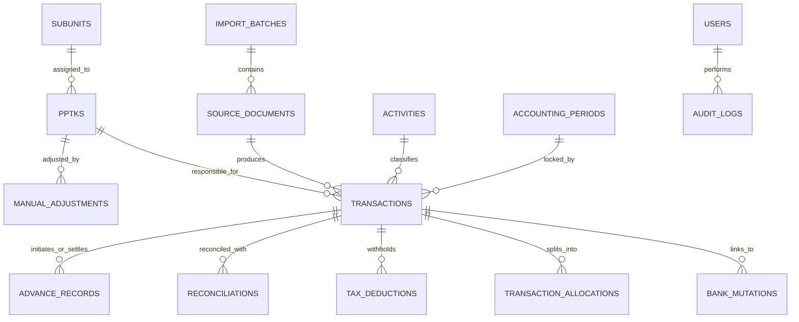

# DOKUMEN RELASI DATA & ARSITEKTUR DATABASE
## APLIKASI DIGITALISASI KEUANGAN SEKRETARIAT DPRD KABUPATEN BANYUMAS

---

## 1. PRINSIP ARSITEKTUR DATA: "SATU SUMBER, BANYAK TAMPILAN"

Masalah utama pada sistem pencatatan manual berbasis spreadsheet adalah **redundansi data** (*data duplication*). Satu pengeluaran panjar tunai atau debet toko harus diketik ulang pada 3 hingga 5 lembar kerja yang berbeda:
1. Diketik di Buku Bank (saat mutasi kas terjadi).
2. Diketik di BKU UP (saat mutasi kas persediaan diakui).
3. Diketik di Kas Kecil (KK) bila melibatkan fisik uang tunai.
4. Diketik di Buku Deb Rekening (bila melalui mesin EDC / debet giro).
5. Diketik di Buku Pembantu PPTK masing-masing.
6. Diketik kembali pada rekap bulanan `Jml Deb Rek` dan ringkasan eksekutif `Hitungan`.

Aplikasi ini mengadopsi prinsip **Single Source of Truth (SSOT)**:
> **Setiap transaksi keuangan hanya dicatat/diimpor SATU KALI.**
> Seluruh lembar BKU, Buku Bank, Buku Pembantu PPTK, dan Rekapitulasi dihitung dan dirender secara dinamis melalui relasi database terstruktur.

---

## 2. DIAGRAM HUBUNGAN ENTITAS (ENTITY-RELATIONSHIP DIAGRAM)

---

## 3. DEFINISI ENTITAS DATABASE RELASIONAL

### 3.1. Tabel `users` & `roles` (Autentikasi & Kewenangan)
Menyimpan identitas pegawai dan hak akses sistem:
- `id` (PK, BigInt)
- `name` (String: Nama lengkap & gelar)
- `nip` (String: Nomor Induk Pegawai)
- `email` (String, Unique)
- `password` (String, Hashed)
- `role` (Enum: `admin`, `bendahara`, `operator`, `kasubag`, `viewer`)
- `is_active` (Boolean)
- `timestamps`

### 3.2. Tabel `master_settings` (Konfigurasi SKPD & Pejabat)
Menampung identitas dokumen yang dapat berubah sewaktu-waktu:
- `id` (PK, BigInt)
- `fiscal_year` (Integer: 2026)
- `skpd_name` (String: "SETWAN KABUPATEN BANYUMAS")
- `pa_kpa_name` (String: Pejabat Pengguna Anggaran aktif, misal "ARIF TRIYANTO, S.Sos. M.Eng.")
- `pa_kpa_nip` (String: NIP Pejabat PA)
- `treasurer_name` (String: "INDAH SETIYOWATI, A.Md.AB.")
- `treasurer_nip` (String: NIP Bendahara Pengeluaran)
- `effective_start_date` (Date)
- `effective_end_date` (Date)

### 3.3. Tabel `subunits` & `pptks` (Master Organisasi & PPTK)
Menyimpan master 9 PPTK Setwan DPRD:
- `id` (PK, BigInt)
- `code` (String: misal `AUL_ETY`, `GAYA`, `RATMAN`, `AUL_RINA`, `SIGIT`, `SGNG_SYESA`, `SGNG_EMI`, `SRI_L`, `IRNA`)
- `name` (String: Nama resmi, misal "SURATMAN, S.E.")
- `display_name` (String: Label Excel, misal "P Ratman")
- `nip` (String)
- `section_name` (String: Subbagian/Bagian)
- `sheet_name` (String: Nama sheet BKU Excel yang merepresentasikan PPTK ini)
- `color_tag` (String: Kode hex warna untuk visualisasi)
- `is_active` (Boolean)

### 3.4. Tabel `activities` (Master Program & Kegiatan Anggaran)
Menampung program kerja/mata anggaran:
- `id` (PK, BigInt)
- `code` (String: Kode rekening / kegiatan SIPD)
- `name` (String: Nama kegiatan, misal "Penyediaan Bahan Logistik Kantor", "Reses 1", dsb)
- `pptk_id` (FK to `pptks`)
- `pagu_budget` (Decimal: 15, 2)

### 3.5. Tabel `import_batches` & `source_documents` (Audit Dokumen Sumber)
Menyimpan riwayat impor multi-transaksi:
- `id` (PK, BigInt)
- `batch_number` (String: Kode unik batch impor)
- `import_type` (Enum: `paste_text`, `pdf_upload`, `manual_entry`, `excel_seed`)
- `original_filename` (String, nullable)
- `raw_content` (LongText: Teks hasil paste atau hasil ekstraksi PDF)
- `parsed_count` (Integer: Jumlah record terdeteksi)
- `status` (Enum: `draft`, `reviewed`, `booked`, `rejected`)
- `user_id` (FK to `users`)
- `timestamps`

### 3.6. Tabel `transactions` (Tabel Inti Transaksi Keuangan)
Tabel utama pembukuan keuangan:
- `id` (PK, BigInt)
- `batch_id` (FK to `import_batches`, nullable)
- `transaction_date` (Date: Tanggal transaksi)
- `document_number` (String: Nomor bukti / SP2D / No Transaksi)
- `description` (Text: Uraian lengkap transaksi)
- `transaction_type` (Enum: 
  - `sp2d_up` : Pencairan Uang Persediaan
  - `sp2d_ls` : Belanja Langsung (Gaji/BOP)
  - `sp2d_tu` : Tambah Uang (misal Reses)
  - `sp2d_gu` : Ganti Uang (Pertanggungjawaban)
  - `panjar_disbursement` : Penyerahan panjar tunai
  - `panjar_return` : Pengembalian sisa panjar tunai
  - `debet_rekening` : Belanja debet langsung toko/vendor
  - `spj_realization` : Pengakuan SPJ definitif
  - `bank_interest` : Bunga giro (Jagir)
  - `bank_tax` : Pajak bunga bank / admin
)
- `payment_method` (Enum: `bank_transfer`, `cash_tunai`, `debit_card_giro`)
- `amount_gross` (Decimal: 15, 2: Nominal bruto)
- `amount_tax` (Decimal: 15, 2: Total potongan pajak)
- `amount_net` (Decimal: 15, 2: Nominal bersih/netto)
- `pptk_id` (FK to `pptks`, nullable bila umum/gaji)
- `activity_id` (FK to `activities`, nullable)
- `vendor_name` (String: Nama toko/rekanan/pihak ketiga, misal "Rita Pasaraya", "Nasmoco")
- `period_month` (SmallInt: 1 s.d. 12)
- `period_year` (SmallInt: 2026)
- `is_verified` (Boolean: Sudah diverifikasi oleh operator/bendahara)
- `status` (Enum: `draft`, `verified`, `posted`, `void`)
- `notes` (Text: Keterangan tambahan)
- `timestamps`

### 3.7. Tabel `transaction_allocations` (Pemisahan Porsi Belanja / Multi-PPTK)
Digunakan jika satu mutasi bank dipecah ke beberapa alokasi kegiatan/PPTK:
- `id` (PK, BigInt)
- `transaction_id` (FK to `transactions`)
- `pptk_id` (FK to `pptks`)
- `activity_id` (FK to `activities`)
- `amount` (Decimal: 15, 2)
- `notes` (String)

### 3.8. Tabel `tax_deductions` (Rincian Potongan Pajak & PPh 23)
Mencatat rincian pemotongan pajak (misal 2% PPh 23 pada Reses atau PPN):
- `id` (PK, BigInt)
- `transaction_id` (FK to `transactions`)
- `tax_type` (Enum: `pph_21`, `pph_22`, `pph_23_2pct`, `ppn_11`, `daerah`)
- `tax_rate` (Decimal: 5, 4: e.g. 0.0200)
- `taxable_base` (Decimal: 15, 2)
- `tax_amount` (Decimal: 15, 2)
- `ntpn_billing` (String: Kode NTPN / ID Billing setor kas negara)
- `is_settled` (Boolean: Sudah disetor ke Kasda/Kas Negara)

### 3.9. Tabel `manual_adjustments` (Penyesuaian Manual & Koreksi Resmi)
Menggantikan koreksi manual *hardcoded* (seperti catatan Ety -500rb & Genta -3.41jt pada sheet `Jml Deb Rek`):
- `id` (PK, BigInt)
- `pptk_id` (FK to `pptks`)
- `adjustment_date` (Date)
- `period_month` (SmallInt)
- `period_year` (SmallInt)
- `adjustment_type` (Enum: `debet_reduction`, `panjar_correction`, `tax_adjustment`, `other`)
- `amount` (Decimal: 15, 2: Bernilai positif atau negatif)
- `reason` (Text: Alasan resmi penyesuaian, misal "Kompensasi selisih SPJ faktur pemeliharaan mobil")
- `authorized_by` (FK to `users`: Pejabat/Bendahara yang menyetujui)
- `timestamps`

### 3.10. Tabel `reconciliations` (Status Pencocokan Buku Bank & BKU)
Menghubungkan catatan mutasi bank dengan dokumen pertanggungjawaban BKU:
- `id` (PK, BigInt)
- `bank_transaction_id` (FK to `transactions`)
- `bku_transaction_id` (FK to `transactions`, nullable)
- `reconciliation_status` (Enum: `matched`, `unmatched_bank_only`, `unmatched_bku_only`, `amount_mismatch`, `investigate`)
- `discrepancy_amount` (Decimal: 15, 2)
- `checked_by` (FK to `users`)
- `checked_at` (Timestamp)
- `resolution_notes` (Text)

### 3.11. Tabel `audit_logs` (Audit Trail & Keamanan)
Merekam setiap aktivitas modifikasi data keuangan:
- `id` (PK, BigInt)
- `user_id` (FK to `users`)
- `action` (Enum: `create`, `update`, `delete`, `post`, `unpost`, `import`)
- `entity_type` (String: `Transaction`, `ManualAdjustment`, dsb)
- `entity_id` (BigInt)
- `old_values` (JSON)
- `new_values` (JSON)
- `ip_address` (String)
- `user_agent` (String)
- `created_at` (Timestamp)

---

## 4. PROYEKSI DATA KE FORMAT SHEET EXCEL (MULTI-VIEW PROJECTION)

Dengan struktur data relasional di atas, seluruh 20 sheet BKU dan 10 sheet Buku Bank diproyeksikan secara konsisten:

| Tampilan Target (Sheet) | Kriteria Filter / Query Database | Aturan Kolom & Agregasi |
|:-----------------------|:---------------------------------|:-------------------------|
| **Buku Bank (`Jan` s.d. `Okt`)** | `WHERE period_year = 2026 AND period_month = :month AND payment_method IN ('bank_transfer', 'debit_card_giro')` | Menghitung Saldo Berjalan: `Saldo Awal Bulan + SUM(Penerimaan) - SUM(Pengeluaran)`. |
| **Buku Kas Umum UP (`UP`)** | `WHERE period_year = 2026 AND (transaction_type = 'sp2d_up' OR payment_method IN ('cash_tunai', 'debit_card_giro'))` | Menampilkan seluruh mutasi realisasi Uang Persediaan (UP Rp 720 jt) sepanjang tahun anggaran. |
| **Buku Kas Kecil (`KK`)** | `WHERE period_year = 2026 AND payment_method = 'cash_tunai'` | Menampilkan perputaran fisik uang tunai: tarik dari bank (Penerimaan), panjar tunai ke PPTK (Pengeluaran), dan pengembalian sisa tunai (Penerimaan). |
| **Buku Debet Rekening (`Deb Rek`)** | `WHERE transaction_type = 'debet_rekening'` | Menampilkan debet toko. Mengalokasikan otomatis nominal ke kolom PPTK terkait (Kolom H..P) dan baris penyelesaian *contra*. |
| **Buku Pembantu PPTK (`Aul-Ety`, `Ratman`, dsb)** | `WHERE pptk_id = :pptk_id` | Mengelompokkan transaksi per PPTK: Debet Rekening (Col H), Panjar Tunai (Col I), SPJ GU (Col J), dan Sisa Kewajiban (Col K). |
| **Matriks Bulanan (`Jml Deb Rek`)** | `GROUP BY pptk_id, period_month` | Mengagregasi total debet dan total panjar 12 bulan per PPTK, digabung dengan tabel `manual_adjustments`. |
| **Rekapitulasi Eksekutif (`Hitungan`)** | Agregasi tingkat tinggi seluruh PPTK | Menghitung Total Kewajiban (`Debet + Panjar`), Realisasi SPJ, Total Hutang Panjar (`Kewajiban - SPJ`), Posisi Kas di Bank dan Tunai, serta validasi kontrol selisih `= 0`. |
| **Reses (`Reses 1..3` & `Deb Reses 1..3`)** | `WHERE transaction_type = 'sp2d_tu' AND activity_name LIKE '%Reses%'` | Menghitung Bruto, PPh 23 (2%), Netto transfer, dan sisa setoran ke Kasda. |
